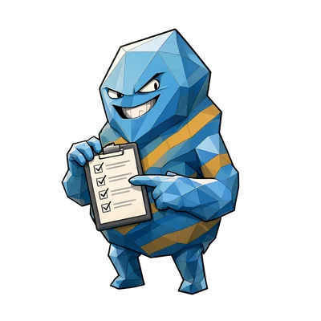
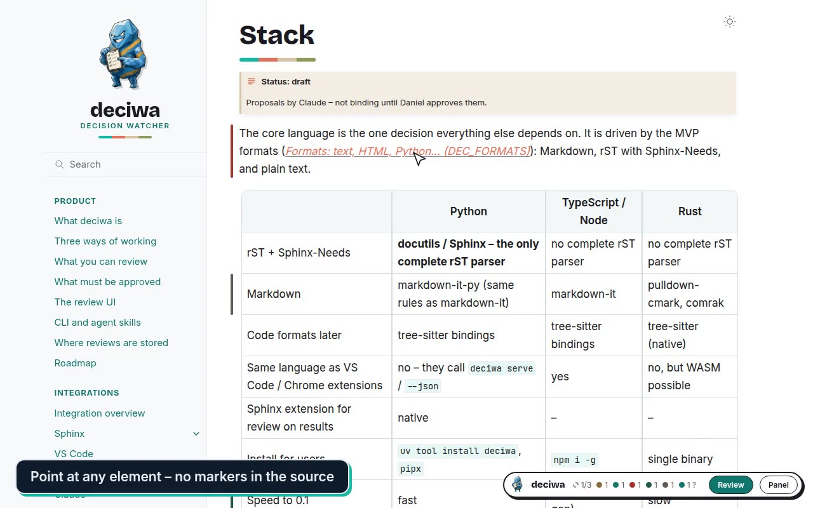
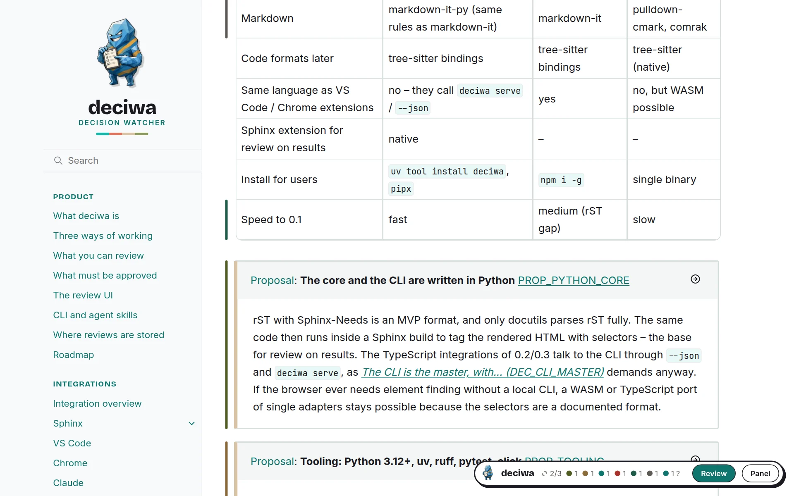
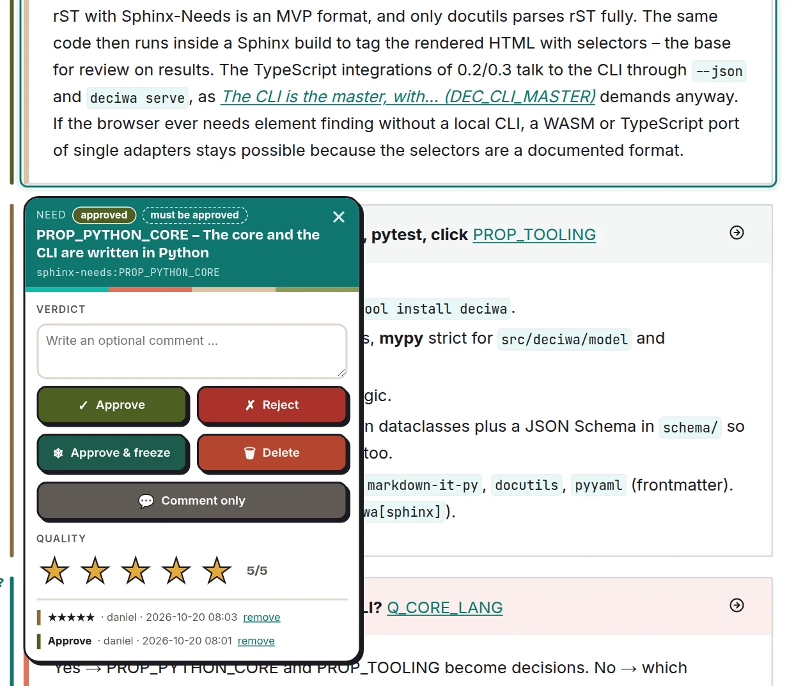
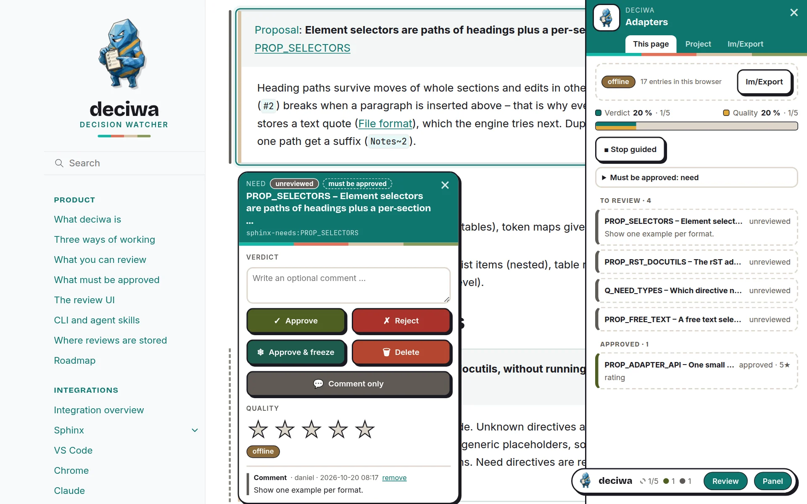
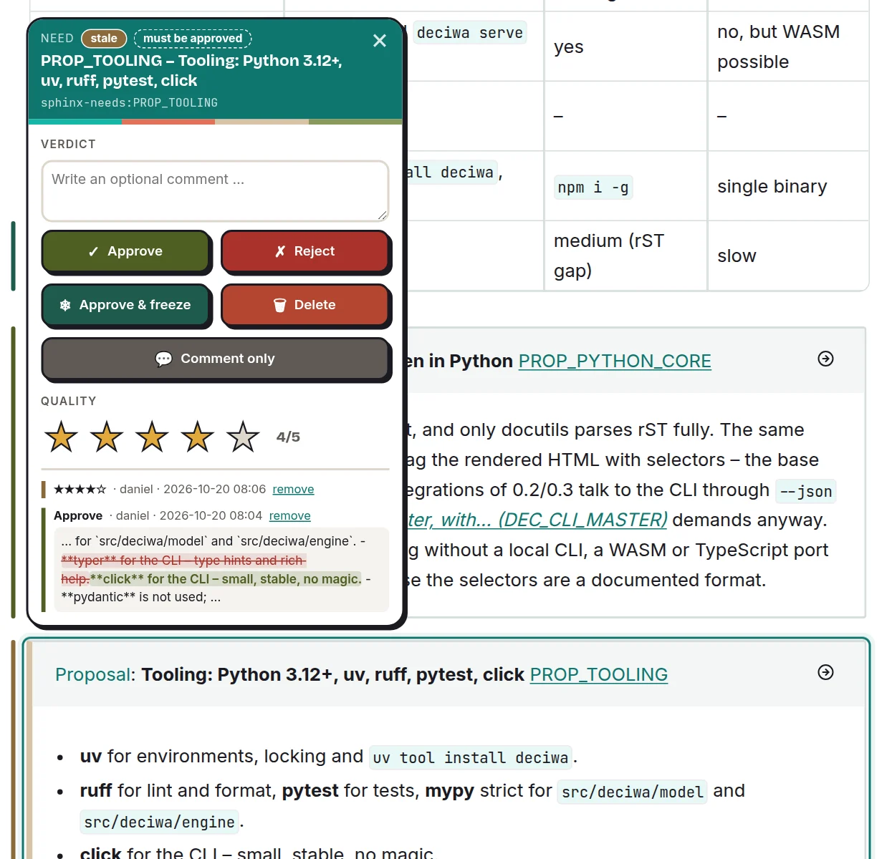
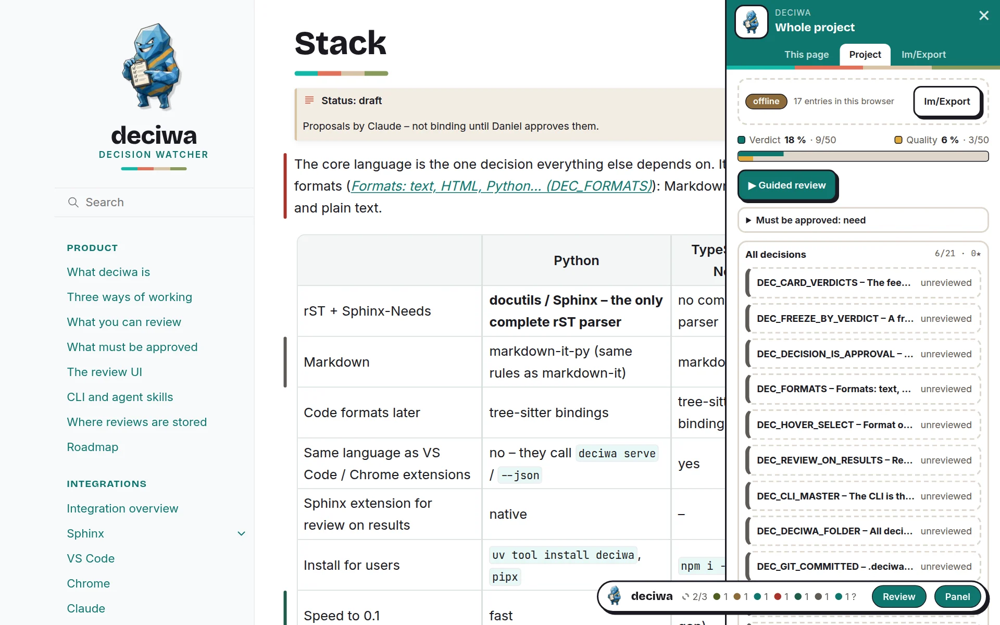

<p align="center">
  
</p>

<h1 align="center">deciwa</h1>

<p align="center">
  <b>decision watcher</b> – point at any part of a doc, a website or a source
  file and say what you think of it.<br>
  deciwa keeps your verdict tied to exactly that spot and notices when it changes.
</p>

<p align="center">
  <a href="https://deciwa.danwos.dev"><b>Docs &amp; live demo</b></a> ·
  <a href="https://deciwa.danwos.dev/demo.html">Try it in the browser</a> ·
  <a href="#development">Development</a>
</p>

> [!WARNING]
> **This is a prototype – a proof of concept, not a product.**
> deciwa was built fast and largely with AI (Claude Code). There are no
> quality measures yet: thin test coverage, no code review, no security
> review, no stable API or file format and no releases. Expect rough edges
> and breaking changes. Use it to try the idea, not for anything that matters.

<p align="center">
  <a href="https://deciwa.danwos.dev">
    
  </a>
  <br><sub>deciwa in 50 seconds – click to watch on the docs page.</sub>
</p>

## Why deciwa

Feedback usually ends up in chats, tickets and comment threads, far away from
the text it is about. A week later nobody knows which wording was agreed on,
and after the next edit nobody notices that an agreed sentence quietly
changed. deciwa puts the feedback on the element itself and keeps watching it.

- **Feedback stays at the element** – a verdict on a paragraph, a requirement
  or a single word stays with it, even when the text moves.
- **Changes do not slip through** – an approved text that is edited later
  shows up as `stale`, with old and new wording side by side; a frozen text
  that changes raises an alarm.
- **Decisions you can see** – an approved statement *is* the decision.
- **The AI asks instead of guessing** – Claude puts its questions right at
  the element; you answer with yes, no or a few words.
- **You know where you stand** – per page and per project, deciwa shows how
  much of what must be approved is approved.
- **Your data stays yours** – reviews live in an open format inside your
  repository and are versioned with Git.

<p align="center">
  
  <br><sub>The bar beside each element shows its state; the deciwa button counts them.</sub>
</p>

## How a review goes

1. **Open the result** – the built docs, the website, the file in your
   editor – and switch review on.
2. **Point and decide** – hover an element, press a key: approve, reject,
   approve & freeze, delete; add stars and a comment if you like.
3. **Let the work happen** – an AI agent or a developer picks up the open
   jobs, changes the text and marks them as done.
4. **See what changed** – changed approvals come back as `stale`.
5. **Track coverage** – watch the share of approved elements grow.

<table>
  <tr>
    <td width="50%"></td>
    <td width="50%"></td>
  </tr>
  <tr>
    <td align="center"><sub>Feedback card on an element</sub></td>
    <td align="center"><sub>Guided review: one open element after the next</sub></td>
  </tr>
  <tr>
    <td width="50%"></td>
    <td width="50%"></td>
  </tr>
  <tr>
    <td align="center"><sub>A changed approval comes back as <code>stale</code></sub></td>
    <td align="center"><sub>Coverage for the whole project</sub></td>
  </tr>
</table>

## Where it runs

| | Where you review | Status |
|---|---|---|
| [Sphinx](https://deciwa.danwos.dev/integrations/sphinx/index.html) | built docs in the browser, with Sphinx-Needs | prototype |
| [Web script](https://deciwa.danwos.dev/integrations/web.html) | any website, with one `<script>` line | prototype |
| [Claude](https://deciwa.danwos.dev/integrations/claude.html) | a conversation with the AI, via the CLI | prototype |
| [monsterbrain](https://deciwa.danwos.dev/integrations/monsterbrain.html) | the danwos desktop app for knowledge folders | development setup |
| VS Code, Chrome, desktop app | – | planned |

## Try it

The quickest way: open the [docs](https://deciwa.danwos.dev) – they run
deciwa themselves. Hover the round button at the bottom right, switch on
**Review** and give feedback on anything you see. Everything stays in your
browser.

On your own Sphinx docs – no packages are published yet, so install from this
repository (Python 3.12+, [uv](https://docs.astral.sh/uv/)):

```console
git clone https://github.com/danwos/deciwa.git
cd deciwa/packages
uv pip install -e core -e server -e cli -e ui -e sphinx   # in your project's environment
```

Add `"deciwa.sphinx"` to `extensions` in your `conf.py`, then in your project:

```console
deciwa init     # creates .deciwa/ in the repository root
deciwa serve    # builds the docs, review them at http://127.0.0.1:4337
```

Details: [Sphinx installation](https://deciwa.danwos.dev/integrations/sphinx/install.html).

---

## Development

```console
uv sync                       # all packages (editable) and the docs tools
.venv/bin/deciwa serve        # build docs/, review them at http://127.0.0.1:4337
```

### Layout

| Folder | What |
|---|---|
| `packages/core` | `deciwa-core` – model, `.deciwa/` store, engine: all the logic |
| `packages/server` | `deciwa-server` – review server: built site + JSON API + rebuild |
| `packages/cli` | `deciwa-cli` – the `deciwa` command |
| `packages/ui` | `deciwa-ui` – the review overlay (JS/CSS); sources in `js/`, `npm ci && npm run build` writes `src/deciwa/ui/static/` (committed) |
| `packages/sphinx` | `deciwa-sphinx` – Sphinx extension (`extensions = ["deciwa.sphinx"]`) |
| `packages/client` | `@danwos/deciwa-client` – finds, starts and calls the engine for host apps (TypeScript) |
| `packages/monsterbrain` | the monsterbrain extension – `docs/integrations/monsterbrain.md` |
| `docs/` | product description, integrations, decisions, technical details – the requirements for all code here; reviewed with deciwa itself |
| `.deciwa/` | review config of the docs (`config.toml` sets what must be approved) |
| `mockups/` | the first clickable mock-up of the feedback UI and the demo recorder |

Package details and rules: `docs/technical/index.md`. How proposals become
decisions: `docs/technical/working.md`.

### Tests

```console
.venv/bin/python -m unittest discover packages/core/tests
(cd packages/ui && npm ci && npm test)
(cd packages/client && npm ci && npm run build && npm test)
```

### Docs

```console
.venv/bin/sphinx-build -W -b html docs docs/_build/html                     # strict build
.venv/bin/sphinx-build -W -b html -D language=de docs docs/_build/html/de   # German
.venv/bin/sphinx-build -E -b html -D deciwa_mode=offline -D deciwa_offline_annotations=0 \
    docs docs/_build/offline                                                # static review build, works from file://
```

Every push to `main` publishes the offline build to
[deciwa.danwos.dev](https://deciwa.danwos.dev) (`.github/workflows/docs.yml`).

### mockups/

- `web-demo.html` – a plain website with the web script. Serve the repository
  root (`python3 -m http.server 4341`) and open
  `http://localhost:4341/mockups/web-demo.html`.
- `feedback-ui.html` – clickable mock-up of the feedback UI. Serve the folder
  (`python3 -m http.server 4330 --directory mockups`) and open
  `http://localhost:4330/feedback-ui.html`. URL parameters for fixed states:
  `clean`, `shot`, `theme`, `file`, `mode`, `variant`, `open`, `rating`,
  `comment`, `scroll`; `?demo=de|en` plays the walk-through used for the
  product video.
- `record-demo.mjs` – records the demo as MP4, GIF and poster image (needs
  google-chrome and ffmpeg): `node mockups/record-demo.mjs de ./out`.
- `assets/` – downscaled deciwa pictures.

---

## License

deciwa is licensed under the [GNU Affero General Public License v3.0](LICENSE)
(AGPL-3.0-only). If you change deciwa and offer it to others – also as a
network service – you must publish your changes under the same license.

Need deciwa under other terms, e.g. inside a closed-source product? A
commercial license is available on request – contact [danwos](https://danwos.dev).

Contributions are not accepted yet; a contributor license agreement will
follow before they are.
